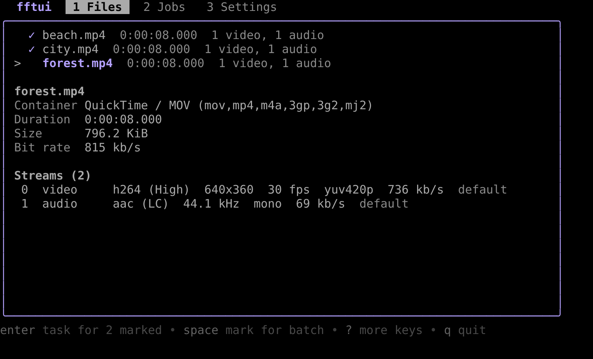
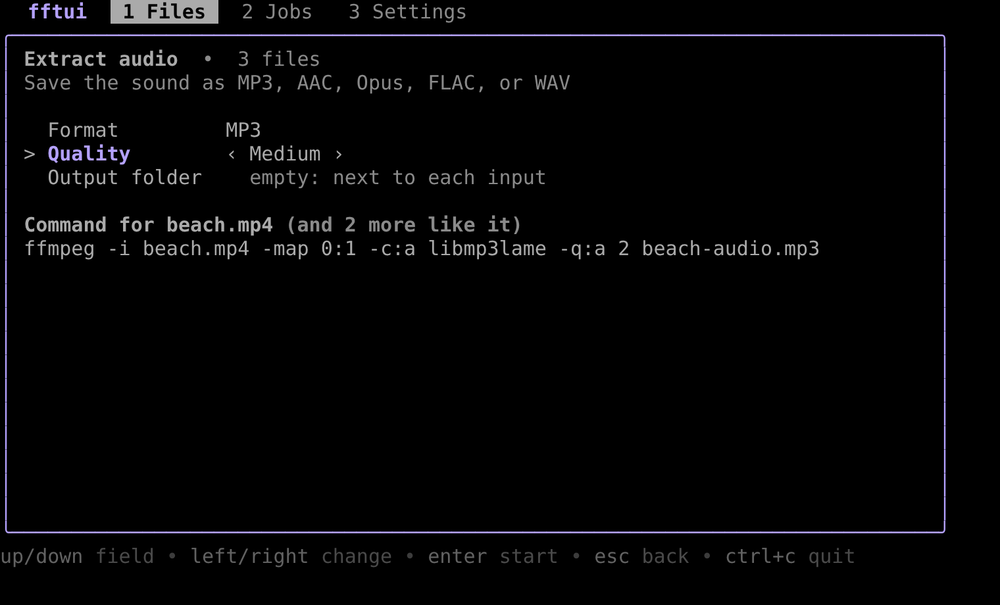
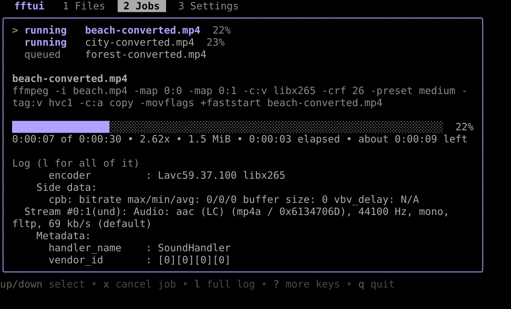
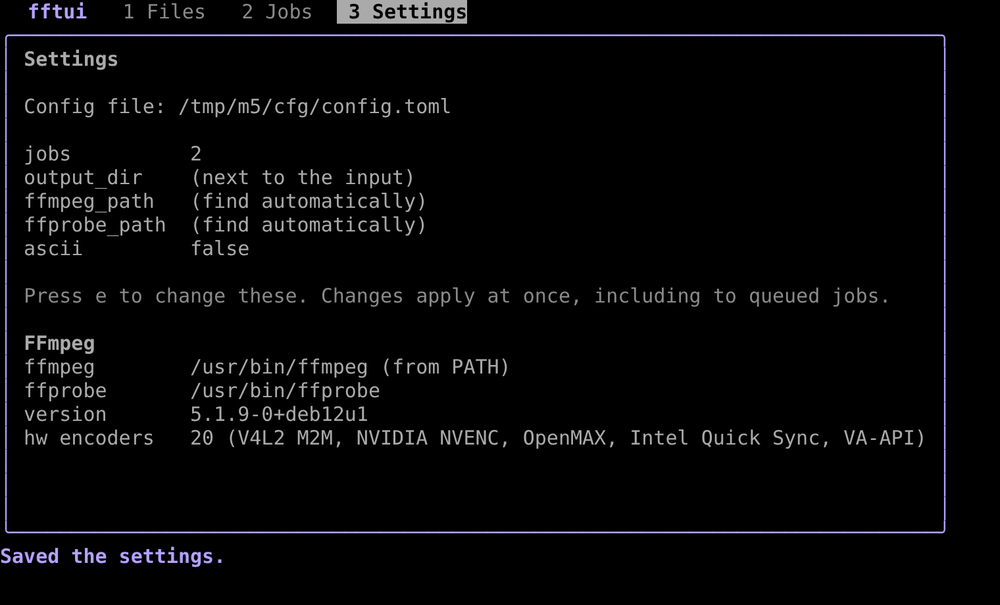

# fftui
FFmpeg but as a TUI

fftui is a terminal interface for FFmpeg that runs on Linux, macOS, Windows, and the BSDs. It is in early development; see [PLAN.md](PLAN.md) for the roadmap.









You need FFmpeg 4.4 or later. fftui looks for `ffmpeg` and `ffprobe` on `PATH` and in the usual install folders, and tells you how to install them if they are missing.

## Install

With Homebrew on macOS or Linux, which also installs FFmpeg:

```sh
brew install part-avocado/tap/fftui
```

With Scoop on Windows, which also installs FFmpeg:

```powershell
scoop bucket add part-avocado https://github.com/part-avocado/scoop
scoop install part-avocado/fftui
```

Or download the archive for your OS from the [releases](https://github.com/part-avocado/fftui/releases), or build from source with Go 1.26.7 or later:

```sh
go install github.com/part-avocado/fftui/cmd/fftui@latest
```

## Usage

```sh
fftui video.mp4 "other clip.mkv"   # open these files to inspect them or run a task
fftui *.mp4                        # open many files and run one task on all of them
fftui -- -i video.mp4 -c:v libx264 out.mkv   # run an FFmpeg command as a job
fftui --ffmpeg /opt/ffmpeg/bin/ffmpeg video.mp4   # use a specific ffmpeg
fftui --ascii    # draw with plain ASCII, for limited terminals or fonts
fftui --config path/to/config.toml
fftui --version
```

Press `tab` and `shift+tab` or `1`–`3` to switch screens, `up`/`down` to choose a file or job, `pgup`/`pgdn` to scroll, `?` for all keys, and `q` to quit. On the Jobs screen, `x` cancels a job and `l` opens its full FFmpeg log.

### Tasks

Press `enter` on a file to choose a task: convert video, change container, compress to a size, extract audio, trim, resize, make a GIF, or choose streams. Tasks that cannot work on the file are greyed out with the reason.

Each task opens a form with the exact FFmpeg command under it, updated as you change the fields. Use `up`/`down` (or `tab`) to move between fields, `left`/`right` to change a choice, and type in text fields. `enter` starts the job and `esc` goes back. `ctrl+y` copies the command, and `ctrl+r` opens it as text to edit before running it. While a form is open every key goes to it, so `ctrl+c` is the only way to quit.

**Batches**: press `space` to mark files (or `a` to mark them all), then `enter` to run one task on every marked file. Each output goes next to its input, or into the output folder you choose. The jobs run `jobs` at a time.

**Custom commands**: choose Custom command at the end of the task list to write the FFmpeg command yourself. It runs exactly as written; quote arguments that have spaces with `'` or `"`.

**Copying**: `ctrl+y` in a form and `c` on the Jobs screen copy the command as one line your shell runs. fftui sends it to the terminal's clipboard (OSC 52, which also works over SSH) and also uses `pbcopy`, `clip.exe`, `wl-copy`, `xclip`, or `xsel` when there is one.

The output file defaults to the input's name with a suffix, in `output_dir` or next to the input. fftui refuses to write over the input and asks before overwriting any other file.

The Encoder field lists the software encoder first, then every hardware encoder your FFmpeg has. It starts on the software encoder every time. If a hardware encoder fails, for example because there is no device or driver, press `s` on the failed job to run it again in software.

Jobs run up to `jobs` at a time (see Configuration). A custom command, or one given after `--`, never overwrites an existing file unless it includes `-y`. When a job fails, fftui shows the line of FFmpeg's log that says why, such as `h264_nvenc: Cannot load libcuda.so.1`, rather than its final "Conversion failed!". Cancelling a job, or quitting while one runs, asks FFmpeg to stop with `q`, so the file written so far stays playable.

fftui uses the first ffmpeg it finds from: the `--ffmpeg` flag, the `FFTUI_FFMPEG` environment variable, `ffmpeg_path` in the config file, `PATH`, then the usual install folders (such as `/opt/homebrew/bin` or Scoop's shims). It uses the `ffprobe` next to that ffmpeg unless `ffprobe_path` is set.

## Configuration

Change the settings on the Settings screen (`3`, then `e`); they are saved to `config.toml` and apply at once, including to jobs already queued. The file lives in fftui's folder under your user config directory:

| OS | Path |
| --- | --- |
| Linux and BSD | `~/.config/fftui/config.toml` (or `$XDG_CONFIG_HOME/fftui`) |
| macOS | `~/Library/Application Support/fftui/config.toml` |
| Windows | `%AppData%\fftui\config.toml` |

You can also edit it by hand; every setting is optional. Saving from the Settings screen rewrites the file, so comments you add are not kept.

```toml
jobs = 1             # FFmpeg jobs that run at once
ffmpeg_path = ""     # custom ffmpeg binary; empty finds it automatically
ffprobe_path = ""    # custom ffprobe binary
output_dir = ""      # default output folder; empty means next to the input
ascii = false        # plain-ASCII drawing
```

## Development

```sh
go test ./...
go vet ./...
goreleaser build --snapshot --clean   # build every release target into dist/
```
